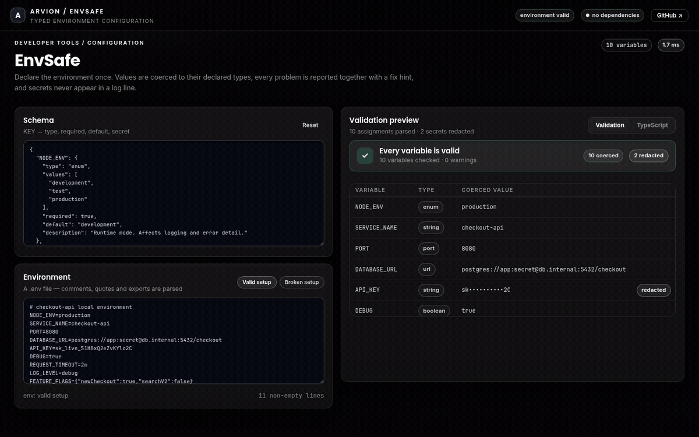
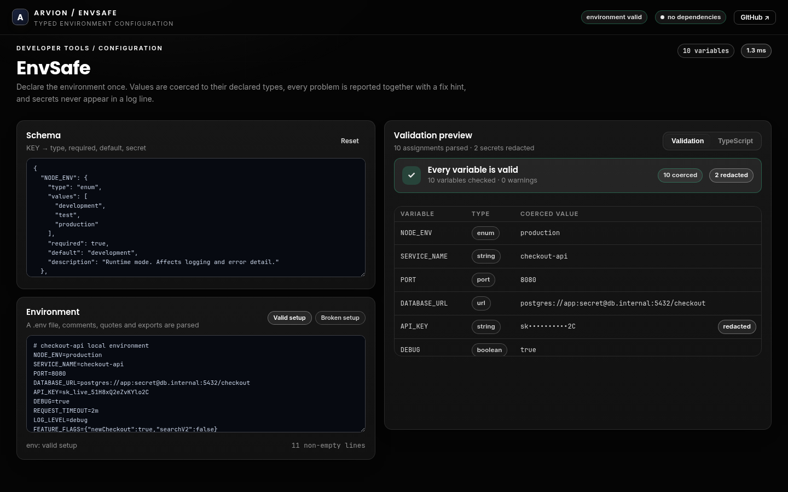
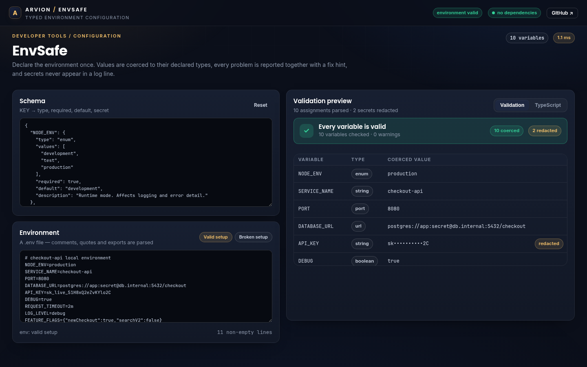

<div align="center">

</div>

<sub>Recorded from the live demo — <a href="docs/demo.mp4">MP4</a> · <a href="docs/screenshot.png">static frame</a></sub>

# EnvSafe

Declare your environment once and let the process fail at startup with readable,
aggregated errors instead of `undefined` at 3am. EnvSafe coerces every value to
its declared type, masks secrets in logs and previews, parses `.env` files and
generates the matching TypeScript interface.

[**Open the live demo**](https://arvion-technology.github.io/labs/demos/envsafe/) · [MIT](LICENSE)

---

Node gives an application strings. Whether `DEBUG=false` should be the boolean
false, or the string `"false"` (which is truthy), is exactly the kind of detail
that survives code review and breaks in production. A schema makes the answer
explicit, and validating once at boot means every later read is already typed.

## What it does

- **Schema DSL** — `string`, `number`, `boolean`, `enum`, `url`, `duration`,
  `json` and `port`, with `required`, `default`, bounds, patterns and
  `protocols`.
- **Coercion** — `"8080"` becomes `8080`, `"yes"` becomes `true`, `"2m"`
  becomes `120000`, `'{"a":1}'` becomes `{ a: 1 }`.
- **Aggregated errors** — every bad variable is reported with the key, the
  reason and a fix hint; the process does not stop at the first one.
- **Secret redaction** — a `secret: true` field is masked in previews, errors
  and the CLI JSON report. The typed value is still available to the app.
- **.env parser** — comments, `export`, single/double quotes, escapes, inline
  comments, duplicate keys (last wins) and line-numbered parse errors.
- **CLI** — `envsafe check`, `envsafe type` and `envsafe example`, with exit
  codes suitable for Docker entrypoints and CI.
- **TypeScript generation** — `toTypeScript(schema)` emits an `Env` interface
  whose optional markers and enum unions match the runtime values.

## Screenshots

| Validation preview | Generated TypeScript |
| --- | --- |
|  |  |

## Architecture

```text
 schema.json                     .env / process.env
      │                                │
      ▼                                ▼
 src/validate.js               src/dotenv.js
 validateSchemaDefinition       parseDotenv -> { values, errors }
      │                                │
      └──────────────┬─────────────────┘
                     ▼
              src/validate.js
              validateEnv -> { values, preview, errors, warnings, secrets }
                     │
        ┌────────────┼──────────────────┐
        ▼            ▼                  ▼
 src/coerce.js   src/typings.js     scripts/cli.mjs
 typed values    TS interface       check | type | example
```

`values` and `preview` are separate on purpose. The application reads `values`;
the logger, the CLI and the demo read `preview`, where secrets are already
masked. A caller cannot accidentally log a secret by formatting the result,
because the raw value is not in the object it would print.

## Quickstart

```bash
git clone https://github.com/arvion-technology/envsafe.git
cd envsafe
npm test          # 37 tests, no dependencies
npm run demo      # serves the playground on http://localhost:4173

node scripts/cli.mjs check --schema examples/env.schema.json --env examples/checkout.env
node scripts/cli.mjs check --schema examples/env.schema.json --env examples/broken.env
node scripts/cli.mjs type  --schema examples/env.schema.json
```

Using it in an application:

```js
import { defineEnv } from "./src/index.js";

const env = defineEnv({
  NODE_ENV: { type: "enum", values: ["development", "production"], default: "development" },
  PORT: { type: "port", required: true },
  DATABASE_URL: { type: "url", required: true, protocols: ["postgres:"] },
  API_KEY: { type: "string", required: true, secret: true, minLength: 12 },
  REQUEST_TIMEOUT: { type: "duration", default: "30s" },
}, { env: process.env });

env.PORT;             // number
env.REQUEST_TIMEOUT;  // 30000
```

If validation fails, `defineEnv` throws one `EnvError` whose message is the
formatted report and whose `errors` array is machine-readable.

## How it works

**Aggregation beats fail-fast for configuration.** A missing `DATABASE_URL` and
a malformed `PORT` are almost always the same incident: someone copied a
half-filled `.env`. Reporting all eight problems with hints produces one fix
cycle; throwing on the first produces eight deploys. The validator loops over
the schema, collects `{ key, message, hint, value? }` entries and only then
decides `ok`.

**Redaction is applied before storage, not before printing.** When a rule sets
`secret: true`, the raw value goes into `values` and the masked form goes into
`preview`; invalid secret values are masked inside the error object as well. The
demo's table renders `preview`, so a screenshot can never expose the key. The
tests assert the raw API key does not appear in the CLI output or the report.

**Durations are a unit, not a number.** `REQUEST_TIMEOUT=30` is ambiguous;
`30s` and `500ms` are not. The parser accepts `ms`, `s`, `m`, `h` and `d`,
returns milliseconds, and rejects a bare number with a hint showing the accepted
forms. The TypeScript generator maps that to `number`, because the interface
describes the coerced value, not the input string.

**The `.env` parser reports line numbers.** A silently skipped line is worse
than a crash: it looks like the variable was never set. Malformed assignments,
invalid names and unterminated quotes become `{ line, message }` entries that
the CLI shows next to the validation errors.

## Tests

```bash
npm test
```

37 `node:test` cases in five files: dotenv syntax and errors, every coercer and
its hints, secret masking, aggregation, defaults, unknown-variable warnings,
schema-definition validation, `defineEnv` throwing behaviour, the TypeScript and
`.env.example` generators, and CLI integration tests that spawn the real binary
against the example files and assert the secret never appears in its output.

```bash
node scripts/serve-check.mjs   # demo asset references and placeholder check
```

## Limitations

There is no runtime accessor that enforces the TypeScript type — the generated
interface is a compile-time aid, not a validator; the validation happens in
`defineEnv`. Values already in `process.env` are strings and are never written
back. The schema language is deliberately small: no nested objects, no
mutually-exclusive fields, no remote schema loading. `.env` parsing does not
support command substitution or variable expansion (`FOO=${BAR}`), and the
parser is line-oriented, so a quoted value cannot span lines. `url` validation
checks syntax and protocol, not reachability.

## Project layout

```text
envsafe/
├── src/
│   ├── coerce.js     # type coercion, bounds, redaction
│   ├── dotenv.js     # .env parser and serialiser
│   ├── validate.js   # schema checks, validateEnv, formatReport
│   ├── typings.js    # TypeScript interface and .env.example
│   ├── index.js      # defineEnv, EnvError, public exports
│   └── samples.js    # the schema and environments used by the demo
├── test/             # 37 node:test cases
├── scripts/cli.mjs   # check | type | example
├── examples/         # schema, valid .env, broken .env
└── demo/             # static playground, imports ../src
```

## Credits

Built by [Arvion Technologies](https://arviontech.net) in Kathmandu as part of
our open-source [Labs](https://github.com/arvion-technology/labs) series. MIT
licensed.
